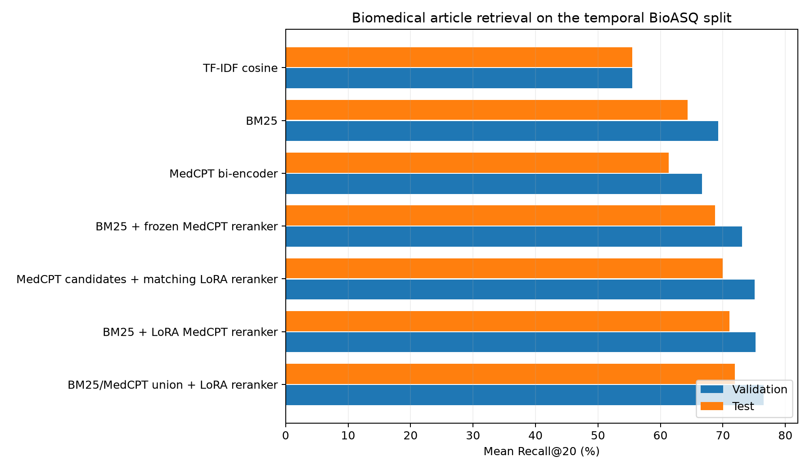

# Hybrid Biomedical Literature Retrieval with BM25 and MedCPT

This project retrieves PubMed articles for biomedical questions. I built a temporal
BioASQ benchmark, established TF-IDF and BM25 baselines, and then tested whether
MedCPT-based semantic retrieval and reranking could recover relevant articles that
lexical ranking placed too low.

The best system combines the top 200 BM25 results with the top 200 MedCPT bi-encoder
results, removes duplicates, and reranks the combined list with a LoRA-adapted MedCPT
cross-encoder. It reached **71.90% mean Recall@20** on the edition-13 test split,
compared with **64.35%** for BM25.



## Results

| Retrieval system | Validation Recall@20 | Test Recall@20 |
|---|---:|---:|
| TF-IDF cosine | 55.49% | 55.51% |
| BM25 | 69.28% | 64.35% |
| MedCPT bi-encoder | 66.64% | 61.32% |
| BM25 + frozen MedCPT reranker | 73.06% | 68.77% |
| MedCPT candidates + matching LoRA reranker | 75.11% | 69.98% |
| BM25 + LoRA MedCPT reranker | 75.23% | 71.05% |
| **BM25/MedCPT union + LoRA reranker** | **76.55%** | **71.90%** |

The hybrid system improves on BM25 by 7.55 percentage points, or 11.74% relative,
on the test split. It retrieves every annotated article within the top 20 for 40.00%
of test questions; BM25 does so for 29.71%.

All displayed values come from the saved experiment summaries. Exact values and
provenance are in [`results/metrics.json`](results/metrics.json). The checks performed
while preparing the repository are recorded in [`VERIFICATION.md`](VERIFICATION.md).

### What Recall@20 means

For one question, Recall@20 is the fraction of its annotated relevant PubMed articles
found among the first 20 results. The reported value is the mean across questions.
The 71.90% result is therefore a retrieval recall—not answer accuracy, classification
accuracy, or precision.

## Method

```text
BioASQ question
      │
      ├── BM25 top 200 ──────────────┐
      │                              ├── deduplicated union
      └── MedCPT bi-encoder top 200 ─┘          │
                                               ▼
                                 LoRA MedCPT cross-encoder
                                               │
                                               ▼
                                     ranked top 20 articles
```

### Data and temporal split

The questions come from the BioASQ 14b training collection. The searchable corpus was
built by collecting the unique PubMed IDs linked from its relevance annotations and
downloading their titles and abstracts through NCBI E-utilities.

| Split | BioASQ editions | Questions | Median annotated articles |
|---|---:|---:|---:|
| Train | 1–11 | 5,049 | 6 |
| Validation | 12 | 340 | 16 |
| Test | 13 | 340 | 18 |

The download requested 58,048 unique PubMed records. After empty records were
excluded, 58,012 title/abstract records were searchable. One training question had no
annotated article remaining in the corpus; every validation and test question had at
least one.

BM25's `k1` and `b` were selected on edition 12. The frozen cross-encoder candidate
depth was also selected on edition 12 from 50, 100, and 200. Editions 1–11 supplied
the LoRA training pairs. Edition 13 was used for the reported temporal test results.

### Retrieval stages

1. **Lexical baselines:** TF-IDF cosine similarity and BM25 over lowercased
   alphanumeric tokens.
2. **Frozen reranking:** `ncbi/MedCPT-Cross-Encoder` reranks BM25's top 200.
3. **Task adaptation:** pairwise LoRA training uses relevant and non-relevant articles
   sampled from each training question's BM25 candidate list.
4. **Dense candidates:** `ncbi/MedCPT-Query-Encoder` and
   `ncbi/MedCPT-Article-Encoder` provide a semantic top 200.
5. **Hybrid retrieval:** lexical and dense candidates are merged and reranked with the
   BM25-trained LoRA adapter.

The main LoRA run used 25,521 pairs from 5,029 training questions, rank 8, alpha 16,
dropout 0.1, learning rate `1e-4`, and one pass through the pairs. The committed
adapter's SHA-256 is recorded in `results/metrics.json`.

## Setup

Python 3.12 was used for the project.

```bash
python3.12 -m venv .venv
source .venv/bin/activate
python -m pip install --upgrade pip
python -m pip install -e ".[all]"
```

PyTorch automatically uses CUDA where available. The scripts also support CPU and
Apple Metal, with an MPS fallback enabled for unsupported operations.

## Prepare the data

The raw BioASQ and PubMed data are not committed. Download the pinned BioASQ
repackaging and then retrieve the linked PubMed records:

```bash
python scripts/prepare_bioasq.py
export NCBI_EMAIL="your-email@example.com"
python scripts/download_pubmed_abstracts.py
```

`NCBI_API_KEY` is optional. The PubMed downloader stores each batch before producing
`data/processed/abstracts.jsonl`, so an interrupted download can continue.

## Reproduce the retrieval runs

Run the stages in this order:

```bash
# Temporal split and lexical baselines
python scripts/tune_bm25.py
python scripts/run_tfidf_recall20.py
python scripts/run_recall20.py
python scripts/eval_bm25_test.py
python scripts/analyze_bm25_misses.py

# Frozen neural reranking and the saved LoRA adapter
python scripts/rerank_medcpt.py
python scripts/train_lora_reranker.py

# Dense retrieval and the final hybrid system
python scripts/rerank_medcpt_bi.py
python scripts/rerank_union_lora.py
```

`train_lora_reranker.py` detects the committed adapter and uses it for evaluation. To
repeat training from scratch, first move that file out of `weights/`; the script will
write a newly trained adapter at the same path. `train_lora_bi.py` reproduces the
separate ablation trained on dense candidate lists.

Neural evaluation is computationally expensive. Intermediate candidate lists,
embeddings, checkpoints, and logs are written under `data/processed/` and ignored by
Git.

Generate the result figure from the committed aggregate metrics with:

```bash
python scripts/plot_results.py
```

## Error analysis

BM25 placed 3,735 annotated test articles in the first 20. Of the annotated articles
it missed, 5,064 shared at least one query term but ranked below position 20; only 28
had no query word. Many errors were therefore ranking errors rather than complete
lexical mismatches. This motivated neural reranking and the addition of dense
candidates.

The MedCPT bi-encoder alone did not beat BM25 at rank 20, but it recovered 593 of the
712 annotated test articles absent from BM25's top 200. Its value was complementary
candidate coverage rather than direct top-20 ranking.

## Limitations

- **Closed corpus:** the corpus is the union of PubMed articles cited by the complete
  BioASQ collection, including validation and test editions. Relevance annotations
  therefore define corpus membership across all splits. The benchmark measures
  ranking inside this known article pool, not retrieval over all of PubMed.
- **Repeated test evaluation:** several architecture variants were evaluated on
  edition 13 during development. It is a held-out temporal test split, but it should
  not be described as an untouched final test selected only once.
- **Incomplete relevance judgments:** an article not annotated by BioASQ may still be
  relevant. Training negatives and measured precision can contain unjudged positives.
- **Titles and abstracts only:** full text, MeSH terms, citation graphs, and publication
  dates were not used.
- **Distribution shift:** later editions contain substantially more annotated articles
  per question than the training editions.
- **Not an official BioASQ submission:** these experiments use a custom closed-corpus
  setup and should not be compared directly with official challenge leaderboards.

## Repository structure

```text
.
├── scripts/
│   ├── prepare_bioasq.py
│   ├── download_pubmed_abstracts.py
│   ├── tune_bm25.py
│   ├── run_tfidf_recall20.py
│   ├── run_recall20.py
│   ├── rerank_medcpt.py
│   ├── train_lora_reranker.py
│   ├── rerank_medcpt_bi.py
│   └── rerank_union_lora.py
├── results/metrics.json
├── weights/medcpt-cross-encoder-lora.pt
├── tests/
└── data/                         # local, ignored experiment data
```

## Tests

The lightweight test suite checks parsing, split assignment, retrieval metrics,
committed result consistency, and the adapter checksum without downloading the dataset
or neural models.

```bash
ruff check .
pytest -q
```

The same checks run in GitHub Actions on Python 3.12.

## Data, models, and attribution

- BioASQ questions and annotations remain subject to the
  [BioASQ dataset terms](https://participants-area.bioasq.org/datasets/). The project
  used the [`JJBauer/bioasq-14b`](https://huggingface.co/datasets/JJBauer/bioasq-14b)
  repackaging and does not redistribute it.
- PubMed records are obtained from [NCBI E-utilities](https://www.ncbi.nlm.nih.gov/books/NBK25501/).
  Publisher-supplied abstracts may carry separate copyright restrictions, so the
  downloaded corpus is not committed.
- The MedCPT encoders and cross-encoder are provided by NCBI. See the
  [MedCPT project](https://github.com/ncbi/MedCPT) and individual Hugging Face model
  cards for their terms.

If you build on the project, cite the BioASQ corpus papers and MedCPT:

1. Krithara et al. “BioASQ-QA: A manually curated corpus for Biomedical Question
   Answering.” *Scientific Data*, 2023.
2. Tsatsaronis et al. “An overview of the BIOASQ large-scale biomedical semantic
   indexing and question answering competition.” *BMC Bioinformatics*, 2015.
3. Jin et al. “MedCPT: Contrastive Pre-trained Transformers with large-scale PubMed
   search logs for zero-shot biomedical information retrieval.” *Bioinformatics*, 2023.
